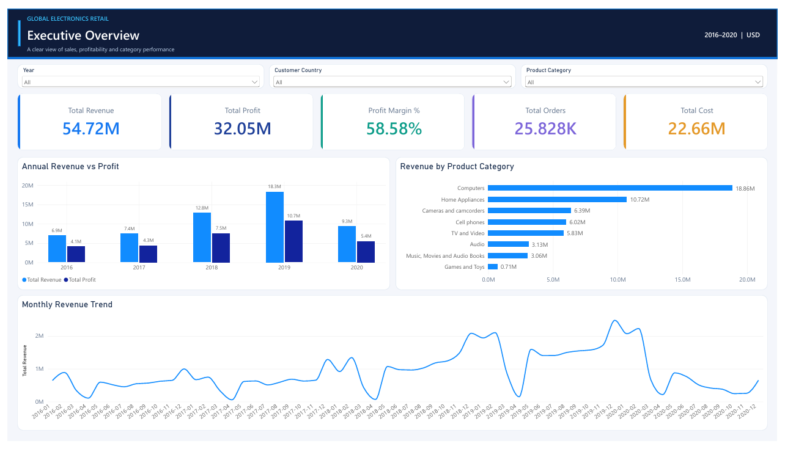
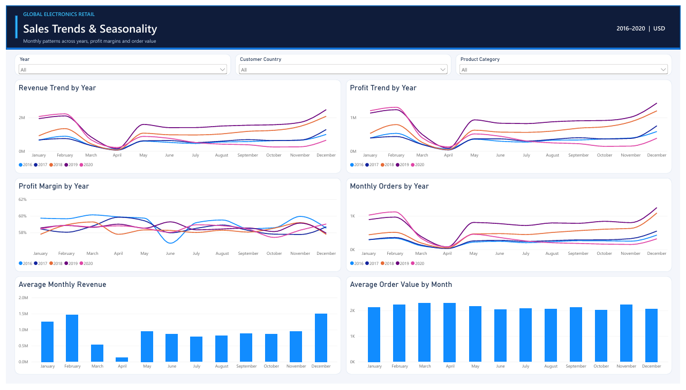
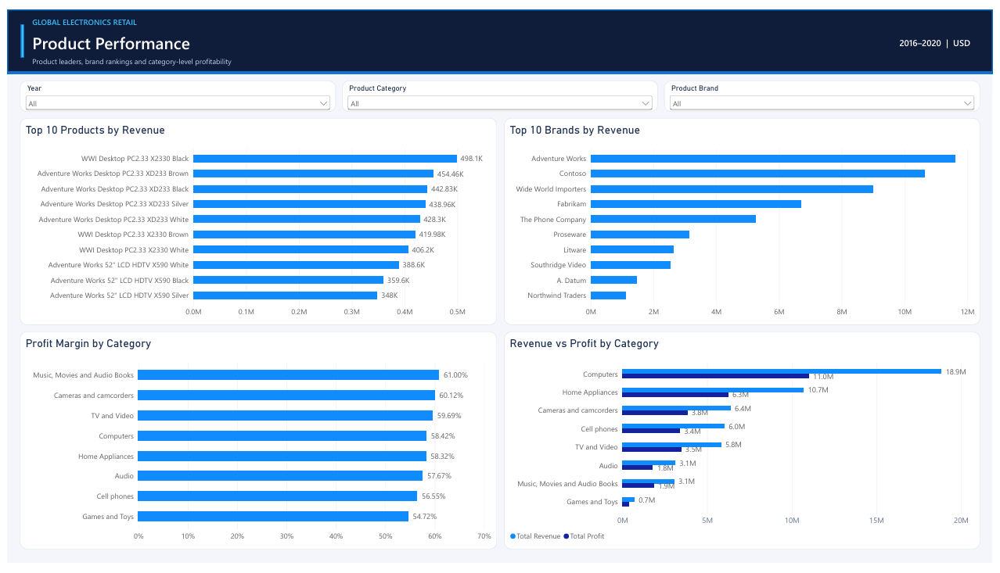
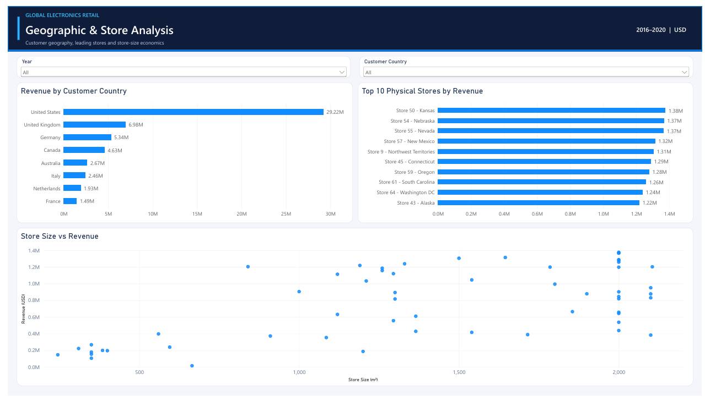
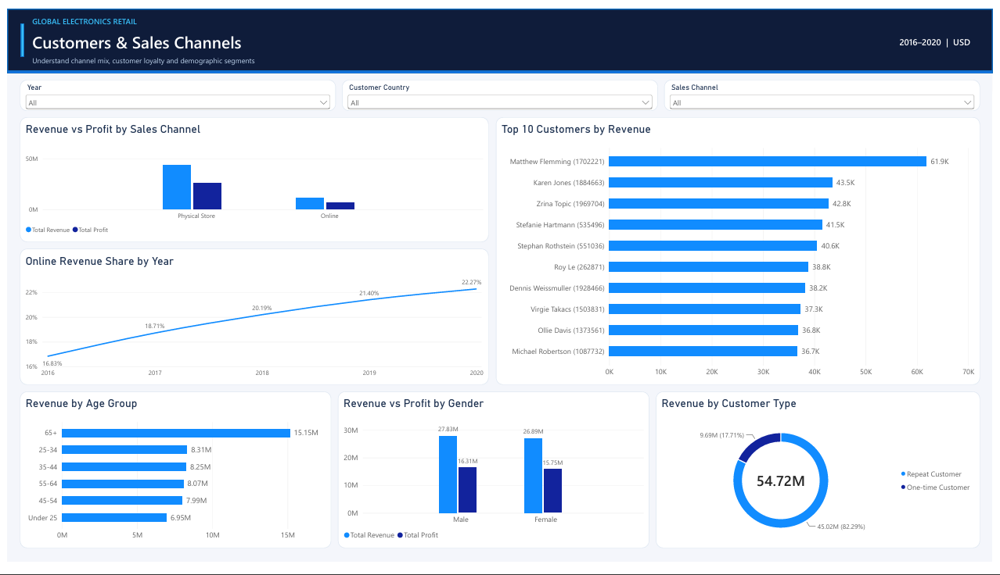
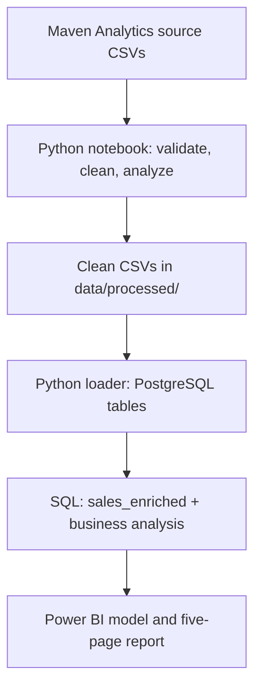

# Global Electronics Retail | Sales & Profitability Analysis

**An end-to-end retail analytics portfolio project using Python, PostgreSQL, SQL, and Power BI.**

This project turns a multi-table retail dataset into a documented analytics workflow: data quality assessment, cleaning and exploratory analysis in Python, relational modeling and business queries in PostgreSQL, and a five-page interactive Power BI report. It examines revenue growth, product profitability, store performance, sales channels, customer behavior, and seasonality.

> **Data and reporting scope:** The source represents a **fictional electronics retailer**, not an actual company's financial results. The interactive dashboard and the headline metrics below cover **five complete calendar years (2016–2020)**, in **USD**. The underlying dataset, Python notebook, and much of the SQL analysis also include **partial 2021 data through February 20, 2021**; see [Reporting scope](#reporting-scope-and-metric-definitions).

**Quick links:** [Dashboard screenshots](#power-bi-dashboard) · [Power BI report (.pbix)](powerbi/global_electronics_retail_dashboard.pbix) · [Five-page PDF report](powerbi/global_electronics_retail_report.pdf) · [Reproduce the project](#getting-started) · [Business questions](#business-questions)

## Project at a glance

| Metric | 2016–2020 result |
| --- | ---: |
| **Total revenue** | **$54,716,191.11** |
| **Total profit** | **$32,054,224.69** |
| **Total product cost** | **$22,661,966.42** |
| **Profit margin** | **58.58%** |
| **Distinct orders** | **25,828** |

*Calculated from order-line quantities and product prices/costs. “Profit” is a product-level gross-profit proxy, **not** accounting net income; the available data does not model operating expenses, taxes, shipping costs, or returns.*



## Business questions

The analysis is organized around practical retail questions:

1. **Sales growth:** How have revenue, profit, order volume, and average order value changed over time?
2. **Category mix:** Which product categories and subcategories contribute the most revenue and profit?
3. **Product portfolio:** Which brands and individual products lead in sales, and how concentrated are those results?
4. **Geographic markets:** Which customer countries and regions generate the most revenue?
5. **Store performance:** Which physical stores perform best, and how is store size associated with revenue?
6. **Sales channels:** How do online and physical-store sales compare in revenue, margins, and average order value? How does online delivery perform?
7. **Customer value:** Who are the highest-value customers, and how much revenue comes from repeat customers?
8. **Demographics:** How do purchasing patterns vary by customer age at purchase and gender?
9. **Seasonality:** Which months consistently record the highest and lowest sales and order volumes?

The queries that answer these questions are grouped and documented in [`sql/electronics_analysis.sql`](sql/electronics_analysis.sql), including delivery-time, order-value, and store-size comparisons.

## Selected findings

The following findings use the **2016–2020 reporting window**, unless stated otherwise.

| Area | Finding | Why it matters |
| --- | --- | --- |
| Growth | Revenue increased from **$6.95M in 2016** to a high of **$18.26M in 2019**, before declining to **$9.29M in 2020**. | Provides a clear starting point for year-over-year investigation. The dataset alone does not establish why revenue declined. |
| Product categories | **Computers** generated **$18.86M**, approximately **34.5%** of report-period revenue; **Home Appliances** followed at **$10.72M**. | Illustrates concentration in a few categories. |
| Geography | The **United States** contributed **$29.22M**, approximately **53.4%** of revenue. | Identifies the largest customer market in this dataset. |
| Channels | Online revenue share rose from **16.83% (2016)** to **22.27% (2020)**, although physical stores remained the larger channel. | Reveals a consistent shift in sales-channel mix. |
| Customers | Repeat customers generated approximately **82.3%** of revenue in the dashboard's customer-type segmentation. | Indicates the importance of repeat purchasing in the observed data. |
| Seasonality | **December** had the highest average monthly revenue across the five complete years, approximately **$1.50M**. | Suggests a recurring seasonal pattern worth investigating. |

**Interpretation caution:** This is illustrative retail data. These patterns describe the provided dataset; they should not be presented as real-world market evidence, causal relationships, or forecasts.

### Revenue and profit by year

| Year | Revenue (USD) | Profit (USD) | Distinct orders |
| --- | ---: | ---: | ---: |
| 2016 | $6,946,793.56 | $4,107,000.47 | 2,865 |
| 2017 | $7,421,422.27 | $4,337,064.06 | 3,280 |
| 2018 | $12,788,960.66 | $7,464,961.11 | 5,965 |
| 2019 | $18,264,382.48 | $10,697,738.90 | 9,083 |
| 2020 | $9,294,632.14 | $5,447,460.15 | 4,635 |
| **Total** | **$54,716,191.11** | **$32,054,224.69** | **25,828** |

## Power BI dashboard

The report contains five audience-facing pages with consistent visual styling, slicers, KPI definitions, and a **2016–2020 | USD** scope label.

| Page | What it answers | Preview |
| --- | --- | --- |
| **1. Executive Overview** | Overall performance, annual revenue vs. profit, category contributions, and monthly trends | [View image](images/executive_overview.png) |
| **2. Sales Trends & Seasonality** | Monthly comparisons across years, monthly order activity, profit margin, and average order value | [View image](images/sales_trends.png) |
| **3. Product Performance** | Top products and brands, profitability by category, revenue vs. profit | [View image](images/product_performance.png) |
| **4. Geographic & Store Analysis** | Customer-country revenue, top physical stores, and store size vs. revenue | [View image](images/geographic_analysis.png) |
| **5. Customers & Sales Channels** | Online vs. store sales, online share trends, leading customers, demographic groups, and loyalty segments | [View image](images/customers_channels.png) |

### Sales trends and seasonality



### Product performance



### Geographic and store analysis



### Customers and sales channels



**Download/open locally:**

- [Interactive Power BI Desktop file](powerbi/global_electronics_retail_dashboard.pbix) — requires Power BI Desktop; refreshing data may require your own PostgreSQL connection and local configuration.
- [Static PDF export of all five report pages](powerbi/global_electronics_retail_report.pdf) — viewable without Power BI.

The working `.pbix` may also contain a **hidden internal KPI validation page** for checking calculations. The public-facing PDF contains the five analytical pages above.

## Tools and analytical methods

| Layer | Tools | Work performed |
| --- | --- | --- |
| Data preparation | Python, pandas, NumPy, Jupyter | Profiling, type corrections, missing-value review, validation, feature preparation, clean exports |
| Exploratory analysis | pandas, Matplotlib | Revenue/profit trends, product and customer analysis, channel comparisons, seasonality |
| Relational storage | PostgreSQL, Python `psycopg` | Five normalized tables, primary/foreign keys, constraints, indexes, repeatable CSV loading |
| SQL analytics | PostgreSQL SQL | Joins, analytical view, aggregates, CTEs, `LAG`, `RANK`, grouped business questions |
| Data storytelling | Power BI, DAX | KPIs, time-series visuals, category and store rankings, slicers, customer/channel comparisons |

### End-to-end pipeline



### Data model

The relational database retains the original source entities rather than flattening everything into a single CSV. `sales` records order lines, linked to the dimension-like tables below.

| Table | Grain / key | Relationship to `sales` |
| --- | --- | --- |
| `sales` | One order line; composite primary key (`order_number`, `line_item`) | Fact table with order, product, store, customer, quantity, currency, and dates |
| `customers` | One customer; `customer_key` | `sales.customer_key` → `customers.customer_key` |
| `products` | One product; `product_key` | `sales.product_key` → `products.product_key` |
| `stores` | One store/channel identifier; `store_key` | `sales.store_key` → `stores.store_key` (key `0` denotes online) |
| `exchange_rates` | One date/currency pair; (`rate_date`, `currency`) | (`sales.order_date`, `sales.currency_code`) → (`rate_date`, `currency`) |

Referential integrity is enforced with PostgreSQL foreign keys. See [`sql/schema.sql`](sql/schema.sql) for data types, constraints, and indexes. A reusable [`sales_enriched` view](sql/electronics_analysis.sql) adds readable attributes, product-level USD calculations, channel classification, customer age at purchase, and delivery duration.

## Data source and dataset availability

**Source:** [Maven Analytics — Global Electronics Retailer](https://mavenanalytics.io/data-playground/global-electronics-retailer). Maven describes this as fictional retail data, credits Microsoft as the source, and lists its license as **Public Domain**. Check the source page for the latest distribution details; obtaining the ZIP may require a free Maven Analytics account.

The downloaded archive contains these source tables:

| File to place in `data/` | Role |
| --- | --- |
| `Sales.csv` | Order-level line items, dates, customer/product/store keys, quantity and currency |
| `Customers.csv` | Customer location and demographic attributes |
| `Products.csv` | Product attributes, unit costs and prices in USD |
| `Stores.csv` | Physical-store geography, size, and opening date; online channel identifier |
| `Exchange_Rates.csv` | Historical currency exchange rates |
| `Data_Dictionary.csv` | Reference definitions from the source distribution |

**The raw CSV files and generated `data/processed/` CSV files are deliberately excluded from GitHub** via `.gitignore`. Downloading and preparing them locally is part of the reproducible setup below. The original `.env` and Python virtual environments are also excluded.

### Data quality and scale

Checks in [`data_preparation.ipynb`](data_preparation.ipynb) cover row counts, data types, primary-key uniqueness, relationship integrity, date ranges, missing data, quantity constraints, and the financial calculations.

| Prepared table | Records (full source period) |
| --- | ---: |
| `sales` | 62,884 order lines |
| `customers` | 15,266 |
| `products` | 2,517 |
| `stores` | 67, including online |
| `exchange_rates` | 11,215 |

The full source contains **26,326 distinct orders** through February 20, 2021. These full-history counts are different from the **25,828 orders** shown on the five-year dashboard. The notebook's validation checks found no duplicated primary keys, orphaned sales relationships, or invalid sold quantities in the prepared tables.

## Reporting scope and metric definitions

The source covers **January 1, 2016–February 20, 2021**. To avoid comparing a partial year with complete years, the published Power BI visuals and the headline findings use **January 1, 2016–December 31, 2020**. The exploratory notebook and several general-purpose SQL queries intentionally retain 2021; apply the same date filter when comparing their outputs with the report.

| Metric | Calculation | Notes |
| --- | --- | --- |
| Revenue | `SUM(quantity * unit_price_usd)` | Product unit prices are already expressed in USD. |
| Product cost | `SUM(quantity * unit_cost_usd)` | Does not include overhead or fulfillment. |
| Profit | Revenue − product cost | Product-level gross-profit proxy. |
| Profit margin | Profit ÷ revenue × 100 | Revenue-weighted margin, not the average of individual margins. |
| Orders | `COUNT(DISTINCT order_number)` | Avoids counting multiple line items as separate orders. |
| Average order value | Revenue ÷ distinct orders | Filter context and reporting period must match. |
| Online revenue share | Online revenue ÷ total revenue × 100 | Calculated within each year, without filtering away physical sales. |
| Sales channel | `store_key = 0` → Online; otherwise Physical Store | Uses the source's store-key convention. |

**Exchange rates:** The `exchange_rates` table is retained for relational integrity and possible currency analysis. It is **not multiplied into the primary financial metrics**, because `Products.csv` already provides unit costs and prices in USD.

For reconciliation: the excluded **partial 2021** period adds about **$1.04M** in revenue and **498 orders** to the complete-history dataset. The full-history totals therefore must **not** be compared directly with the 2016–2020 Power BI KPI cards.

## Getting started

These steps reproduce the Python and PostgreSQL stages on Windows. Run commands from the repository root (the folder containing `data_preparation.ipynb`). The clone URL below assumes the repository will be published under the project name `global-electronics-retail-analysis`; adjust it if you choose a different GitHub repository name.

### Prerequisites

- Python **3.13** (the notebook was run with Python 3.13.14).
- PostgreSQL with permission to create a local database; DBeaver or pgAdmin is optional for executing queries.
- Power BI Desktop on Windows to open the interactive `.pbix` report.
- The raw dataset from [Maven Analytics](https://mavenanalytics.io/data-playground/global-electronics-retailer).

### 1. Clone the project and create a Python environment

```powershell
git clone https://github.com/mohammed56565/global-electronics-retail-analysis.git
cd global-electronics-retail-analysis

py -3.13 -m venv .venv
.\.venv\Scripts\Activate.ps1
python -m pip install -r requirements.txt
python -m pip check
```

> If you are using the project before its GitHub publication, start in your existing local `global-electronics-retail-analysis` folder and skip the `git clone` command. If PowerShell blocks activation, you can use `.\.venv\Scripts\python.exe -m pip ...` directly.

### 2. Download and place the source CSV files

1. Download **Global Electronics Retailer** from the [Maven Analytics Data Playground](https://mavenanalytics.io/data-playground/global-electronics-retailer) and extract its contents.
2. Create a `data/` folder directly inside the repository if one does not exist.
3. Place the six files listed under [Data source and dataset availability](#data-source-and-dataset-availability) in `data/`, keeping their exact filenames and capitalization.

The required raw-data layout is:

```text
global-electronics-retail-analysis/
└── data/                       # ignored by Git
    ├── Sales.csv
    ├── Customers.csv
    ├── Products.csv
    ├── Stores.csv
    ├── Exchange_Rates.csv
    └── Data_Dictionary.csv
```

### 3. Run the data preparation notebook

Open [`data_preparation.ipynb`](data_preparation.ipynb) in VS Code or Jupyter. Select the `.venv` Python kernel, then **Run All** from the repository root. Alternatively, install/open Jupyter using your preferred notebook host.

The notebook reads the source tables, validates and explores them, and writes five cleaned CSV files to:

```text
data/processed/
├── sales_clean.csv
├── products_clean.csv
├── customers_clean.csv
├── stores_clean.csv
└── exchange_rates_clean.csv
```

Do not skip this step: the PostgreSQL loader expects those exact processed filenames.

### 4. Create a PostgreSQL database and configure local credentials

Create an **empty, dedicated** PostgreSQL database named `global_electronics` (e.g., in DBeaver, pgAdmin, or `psql`). From the repository root, make a local environment file:

```powershell
Copy-Item .env.example .env
```

Edit `.env` with your own connection values:

```dotenv
DB_HOST=localhost
DB_PORT=5432
DB_NAME=global_electronics
DB_USER=postgres
DB_PASSWORD=your_actual_local_password
```

**Never commit or share `.env`.** The committed `.env.example` contains placeholders only.

### 5. Create the database schema

With `psql` installed and available in your terminal:

```powershell
psql -U postgres -d global_electronics -f sql/schema.sql
```

Or open [`sql/schema.sql`](sql/schema.sql) in DBeaver or pgAdmin and execute it against `global_electronics`.

> **Destructive-operation warning:** The schema script first drops the existing `sales_enriched` view and project tables before recreating them. **Use a dedicated project database**; do not run it on an existing database containing information you need to keep.

### 6. Load the cleaned data into PostgreSQL

```powershell
python scripts/load_to_postgres.py
```

The loader imports the five prepared CSVs in foreign-key-safe order (`customers` → `products` → `stores` → `exchange_rates` → `sales`). It prints progress and commits once loading succeeds.

> **Re-run behavior:** The loader **TRUNCATES** the five target tables (with `CASCADE`) before inserting fresh data. Running it again replaces the project's existing database contents; do not point it at production or unrelated tables.

### 7. Run the SQL analysis

```powershell
psql -U postgres -d global_electronics -f sql/electronics_analysis.sql
```

Or execute [`sql/electronics_analysis.sql`](sql/electronics_analysis.sql) in DBeaver/pgAdmin. It checks table counts, creates or updates `sales_enriched`, and runs the documented business-analysis queries. You can inspect the view directly:

```sql
SELECT COUNT(*) AS order_lines FROM sales_enriched;

SELECT
    ROUND(SUM(revenue_usd), 2) AS revenue_usd,
    ROUND(SUM(profit_usd), 2) AS profit_usd,
    COUNT(DISTINCT order_number) AS orders
FROM sales_enriched
WHERE order_date >= DATE '2016-01-01'
  AND order_date < DATE '2021-01-01';
```

The second query should return the five-year dashboard totals (approximately **$54.72M revenue**, **$32.05M profit**, and **25,828 orders**) when the same prepared data is loaded.

### 8. Explore the Power BI report

Open [`powerbi/global_electronics_retail_dashboard.pbix`](powerbi/global_electronics_retail_dashboard.pbix) in Power BI Desktop. Use the **Year**, **Customer Country**, **Product Category**, and other page-specific slicers to explore different segments. Use **All** on slicers to reproduce the overall report totals.

The exported [`global_electronics_retail_report.pdf`](powerbi/global_electronics_retail_report.pdf) provides a static five-page portfolio preview. If Power BI prompts for a refresh or unavailable data source, update the local connection settings and confirm your PostgreSQL instance is running before refreshing.

## Repository structure

```text
global-electronics-retail-analysis/
├── README.md
├── .gitignore
├── .env.example
├── requirements.txt
├── data_preparation.ipynb       # validation, cleaning, EDA, exports
├── scripts/
│   └── load_to_postgres.py     # cleansed CSV → PostgreSQL COPY
├── sql/
│   ├── schema.sql              # relational tables, keys, constraints, indexes
│   └── electronics_analysis.sql # enriched view and business queries
├── powerbi/
│   ├── global_electronics_retail_dashboard.pbix
│   └── global_electronics_retail_report.pdf
├── images/
│   ├── executive_overview.png
│   ├── sales_trends.png
│   ├── product_performance.png
│   ├── geographic_analysis.png
│   ├── customers_channels.png
│   └── ...                     # additional Python/EDA charts
└── data/                       # LOCAL ONLY — ignored by Git
    ├── [source CSV files]
    └── processed/              # notebook-generated clean CSVs
```

## Limitations and interpretation

- **Fictional sample:** The source represents a fictional retailer; conclusions are about this dataset only.
- **Partial final year:** Source records continue into February 2021, but 2021 is excluded from the dashboard's complete-year comparisons.
- **Simplified profit:** Revenue minus recorded product unit cost does not account for returns, discounts, taxes, payroll, rent, shipping, or other operating expenses.
- **USD convention:** Product price and cost fields are already USD; historical exchange rates are not used to restate the core measures.
- **Observational patterns:** Differences across demographics, locations, years, and store sizes are descriptive, not evidence of causation.
- **Environment-specific refresh:** The `.pbix` can be opened independently, but data-refresh connections may need to be configured for another user's local PostgreSQL installation.
- **Local data requirement:** CSV files are intentionally not versioned. Reproduction requires retrieving the dataset from the linked source and running the preparation stage.

## Author and attribution

**Mohammed Alharbi** · [GitHub profile](https://github.com/mohammed56565)

- **Dataset:** [Global Electronics Retailer — Maven Analytics Data Playground](https://mavenanalytics.io/data-playground/global-electronics-retailer) (fictional retail data; source credited to Microsoft; listed by Maven as Public Domain).
- **Analysis, SQL pipeline, and report:** Portfolio implementation by Mohammed Alharbi.

*This repository is an educational and portfolio analysis. It is not affiliated with, endorsed by, or a financial statement of any real electronics retailer.*
